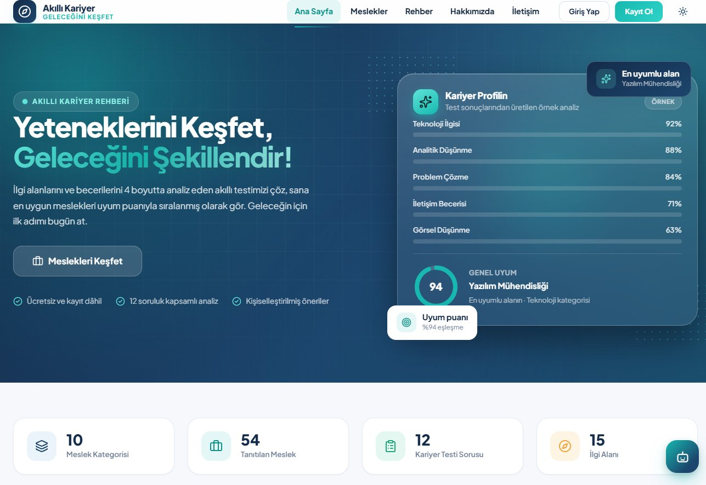
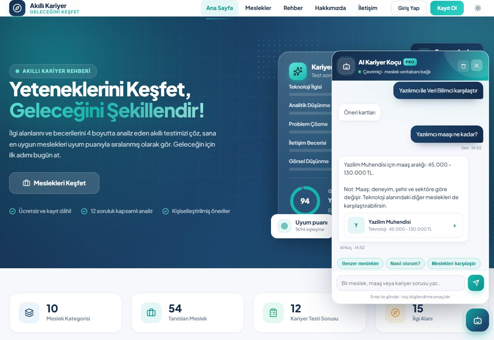
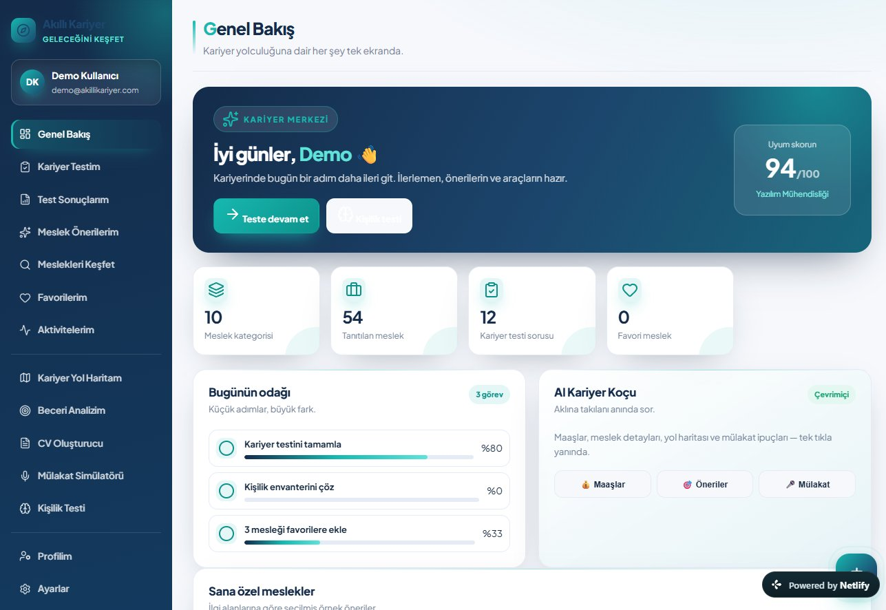
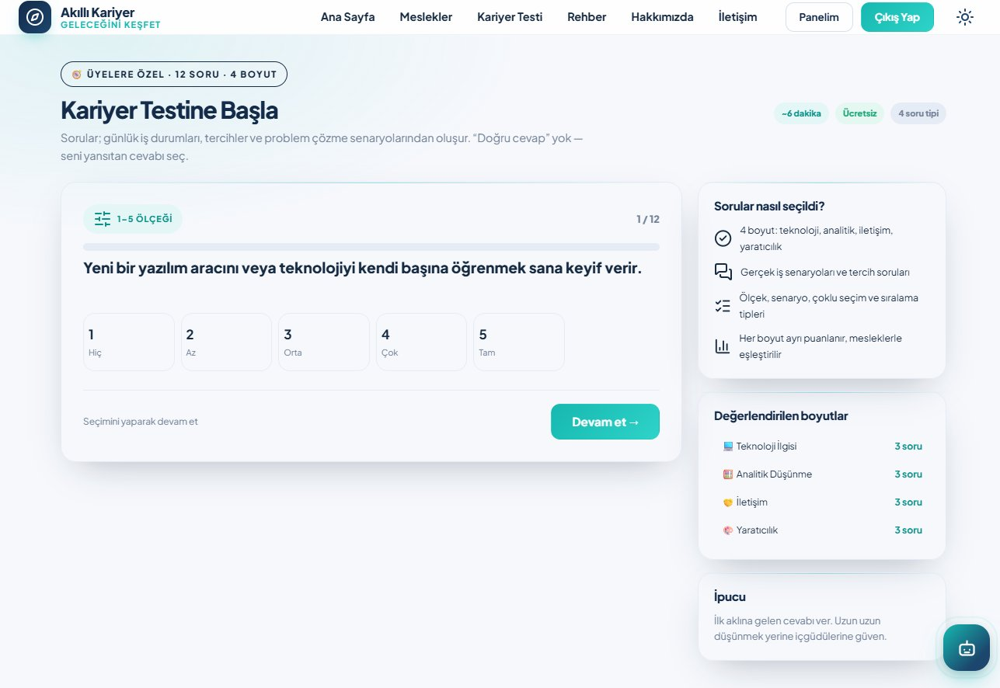

# 🎓 Akıllı Meslek ve Kariyer Rehberi

**Professional Career Discovery & Guidance Platform**

Türkiye'deki öğrencilerin ilgi alanlarını, yeteneklerini ve çalışma tercihlerini keşfetmelerini sağlayan; gerçek MySQL veritabanına bağlı, PHP ile geliştirilmiş kapsamlı bir kariyer rehberi platformu.

Bu depo, projenin **tek seferde eksiksiz geliştirilmiş** hâlidir: kök klasörde çalışan PHP/MySQL uygulaması, `netlify-static/` klasöründe ise canlıda yayında olan statik sürüm bulunur.

🌐 **Canlı site:** [https://akillikariyer.netlify.app](https://akillikariyer.netlify.app)

---

## 📸 Uygulamadan Görüntüler

### Ana Sayfa — Premium Landing Page


### AI Kariyer Koçu — Akıllı Asistan


### Üye Paneli — Kişisel Kariyer Merkezi


### Kariyer Testi — 12 Soru, 4 Boyut


---

## 🎯 Bu Uygulamayı Neden Yaptık?

Öğrenciler kariyer seçerken çoğu zaman çevre baskısı, popüler meslekler ve eksik bilgiyle karar veriyor. "Bu iş bana uygun mu?" sorusu sezgiye dayalı kalıyor. **Akıllı Kariyer Rehberi**, bu kararı veriye dayalı bir keşif sürecine dönüştürüyor.

Uygulama; kullanıcının ilgi alanlarını, yeteneklerini, çalışma alışkanlıklarını ve kişisel tercihlerini analiz ederek kişiye özel meslek önerileri üretir. Sonuçlar kesin meslek tayini değil; öğrenciye alternatifleri gösteren ve kendini tanımasını sağlayan rehberlik çıktılarıdır.

**Temel hedef:** Göstermelik butonlar, boş sayfalar veya sahte giriş sistemleri olmadan; bütün sayfaları birbirine bağlı, veritabanıyla çalışan, gerçekten işlevsel bir web platformu sunmak.

---

## ✨ Neler Yaptık?

### Kimlik ve Güvenlik
- Gerçek kayıt/giriş sistemi — `password_hash()` / `password_verify()`
- PHP Session, CSRF token, hazırlanmış SQL ifadeleri (PDO prepared statements)
- Giriş denemesi takibi, yetki kontrolü, XSS koruması
- Admin ve üye rolleri ayrı yetkilendirme

### Kariyer Testi ve Eşleştirme
- 4 boyutta analiz: Teknoloji, Analitik Düşünme, İletişim, Yaratıcılık
- Farklı soru tipleri: 1–5 ölçek, senaryo, tercih ve çoklu seçim
- Her sorunun boyutlara göre ağırlıklandırılması
- 0–100 arası uyum puanı ve sıralı meslek önerileri
- Sonuçların kaydedilmesi, panelde görüntülenmesi ve AI koç tarafından yorumlanması
- Big Five kişilik testi (20 soru) ve 8 soruluk mülakat simülatörü

### AI Kariyer Koçu (v2)
- Bağlam hatırlama, meslek/kategori ayrımı, akıllı arama
- İki mesleği karşılaştırma, mini kariyer testi, günün mesleği
- Maaş/eğitim/yol haritası soruları, kayıtlı test sonucunu yorumlama
- Geri bildirim (👍/👎), yanıt kopyalama, sohbet geçmişi, koyu tema

### Katalog ve İçerik
- 54 meslek, 10 kategori, meslek detay sayfaları
- Arama, kategori filtreleri, favoriler, görüntülenen meslekler
- Kariyer rehberi / blog içerikleri ve yönetimi

### Üye ve Yönetim Panelleri
- Üye paneli: genel bakış, testler, sonuçlar, öneriler, keşfet, favoriler, aktivite, yol haritası, beceri analizi, CV oluşturucu, profil, ayarlar
- Ayarlar: 7 sekme, tema/renk tercihleri, bildirim anahtarları, veri indirme/sıfırlama
- Admin paneli: kullanıcı, meslek, kategori, soru, blog ve sistem ayarları yönetimi

### Tasarım
- Premium SaaS görünümü, #142B4A / #1C466D / #16B8B0 paleti
- Responsive düzen, mobil menü, açık/koyu tema
- Akıcı animasyonlar, mikro etkileşimler, erişilebilir odak durumları

---

## 🛠 Teknoloji Yığını

| Katman | Teknoloji |
| --- | --- |
| Backend | PHP 8.2+, PDO, MySQL/MariaDB, Session, CSRF |
| Frontend | HTML5, CSS3, JavaScript ES6+, Bootstrap 5.3, Chart.js, Lucide Icons |
| Statik sürüm | Netlify (HTML/CSS/JS, localStorage oturum demosu) |
| Veri | 26 MySQL tablosu, JSON meslek verisi |

---

## 📁 Klasör Yapısı

```
akilli-kariyer/
├── index.php, careers.php, career-test.php, test-result.php ...   # Herkese açık sayfalar
├── app/               # Core, Models, Services, Helpers (MVC mantığı)
├── config/            # app.php, database.php
├── includes/          # header, footer, navbar, panel şablonları
├── dashboard/         # Üye paneli
├── admin/             # Yönetim paneli
├── api/               # JSON API uç noktaları
├── assets/            # CSS, JS, görseller, fontlar, meslek verisi
├── database/          # database.sql (şema + başlangıç verileri)
├── netlify-static/    # Canlı Netlify sitesinin tamamı
├── tools/             # Veri üretim ve yardımcı betikler
├── docs/screenshots/  # Bu README'deki ekran görüntüleri
├── KARİYER REHBERİ PRONTU.md
└── README.md
```

---

## 🚀 Kurulum (PHP + MySQL)

Gereksinimler: XAMPP / PHP 8.2+ / MySQL 8 veya MariaDB.

1. MySQL sunucusunu başlat.
2. Veritabanını içe aktar:

```bash
mysql -u root < database/database.sql
```

3. Bağlantı bilgilerini `config/app.php` ve `config/database.php` içinde düzenle.
4. PHP sunucusunu başlat:

```bash
php -S 127.0.0.1:8080 -t .
```

5. Tarayıcıdan `http://127.0.0.1:8080` adresini aç.

### Demo hesaplar

| Rol | E-posta | Şifre |
| --- | --- | --- |
| Üye | `demo@akillikariyer.com` | `Demo!2345` |
| Admin | `admin@akillikariyer.com` | `Admin!2345` |

### Statik sürüm

`netlify-static/` klasörünü doğrudan Netlify Drop'a sürükleyerek aynı arayüzü PHP olmadan da yayınlayabilirsin. Bu sürümde oturum, favoriler ve test sonuçları tarayıcıda (`localStorage`) saklanır.

---

## 📄 Proje Prontusu

Uygulamanın hangi gereksinimler üzerine geliştirildiği, tüm teknik ve tasarım kararları bu dosyada yer alıyor:

**[KARİYER REHBERİ PRONTU.md](KAR%C4%B0YER%20REHBER%C4%B0%20PRONTU.md)**

### 📊 Değerlendirme rubriğine karşılık

100 puanlık değerlendirme kriterlerinin hangi dosyalarla karşılandığı ve öz değerlendirme:

**[docs/DEGERLENDIRME.md](docs/DEGERLENDIRME.md)**

---

> Bu proje eğitim amaçlıdır. Kariyer testi klinik bir psikolojik değerlendirme değil, rehberlik aracıdır.
